# API请求性能优化流程图

本文档描述API请求性能优化的流程图，包括请求缓存机制、并发控制、拦截器优化和性能对比。

## 1. 请求缓存机制流程图

### 1.1 缓存命中流程

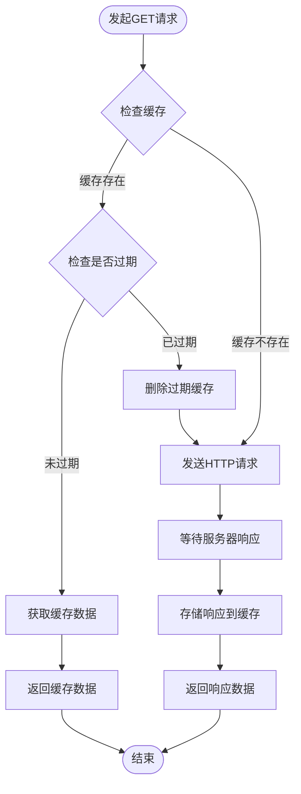

### 1.2 缓存失效流程

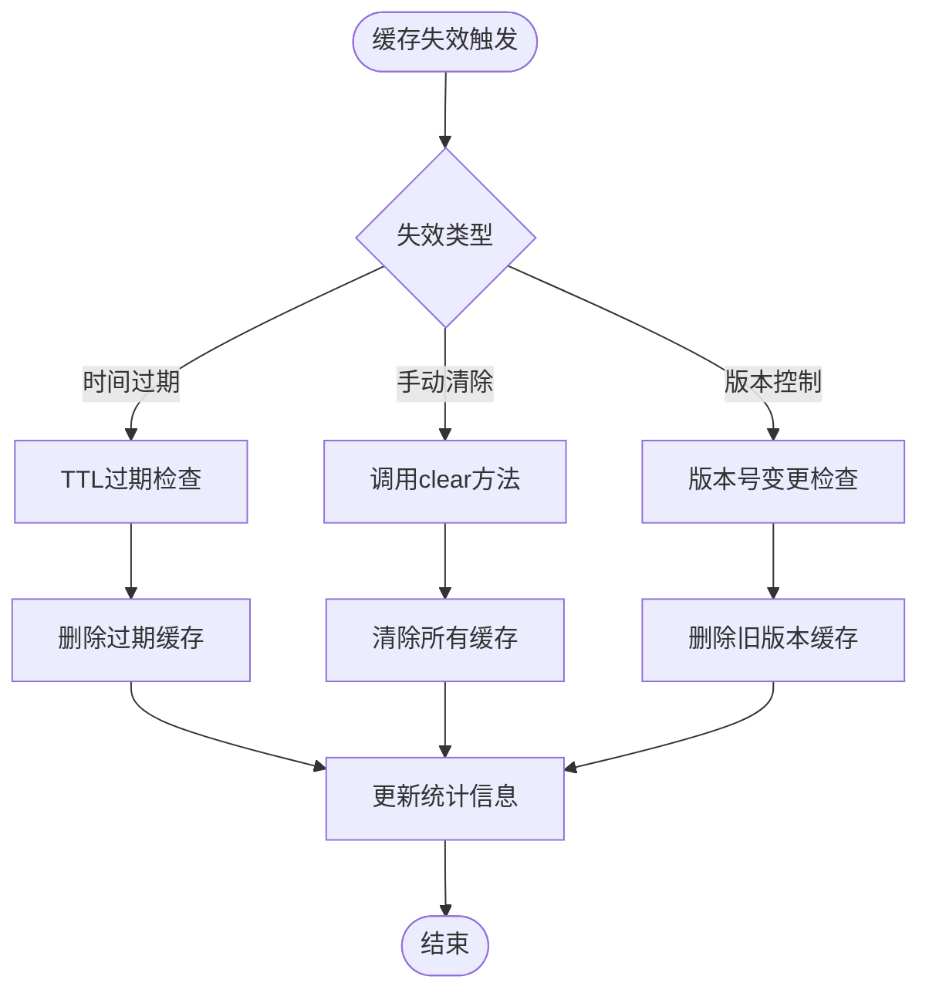

### 1.3 缓存更新流程

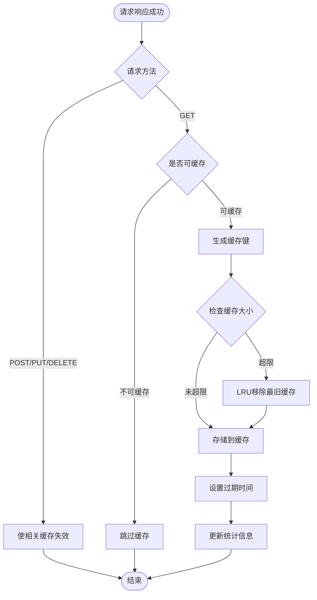

## 2. 请求并发控制流程图

### 2.1 请求队列处理流程

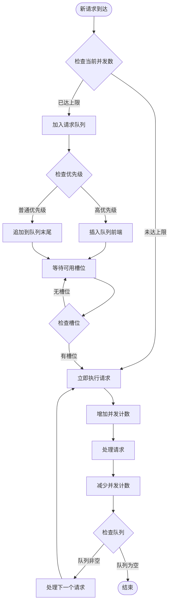

### 2.2 请求去重流程

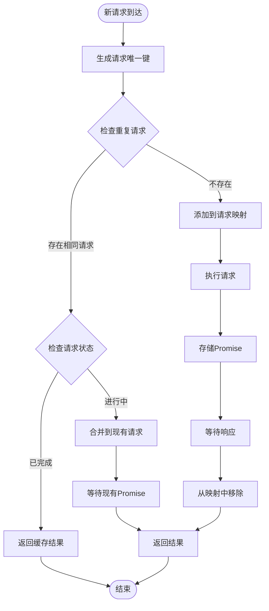

### 2.3 优先级处理流程

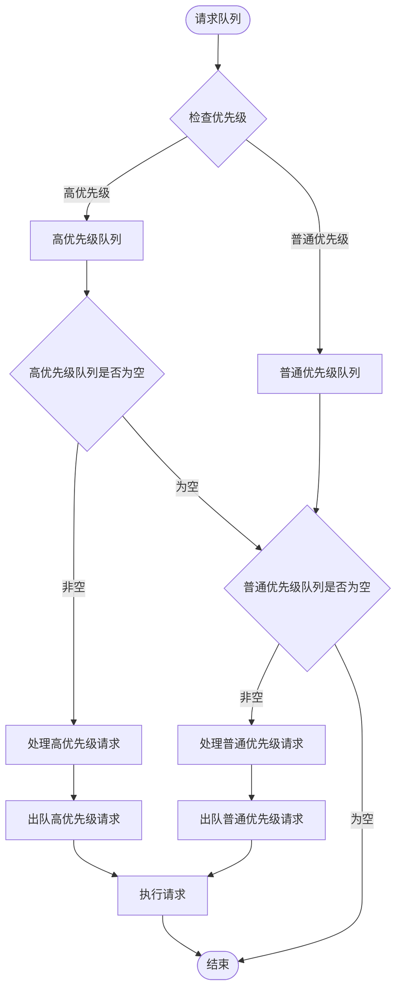

## 3. 请求拦截器性能优化流程图

### 3.1 优化前流程

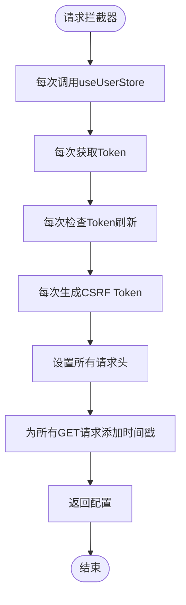

### 3.2 优化后流程

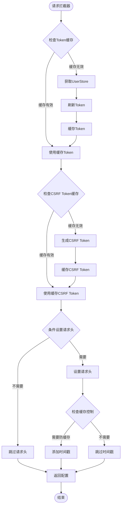

### 3.3 性能优化对比

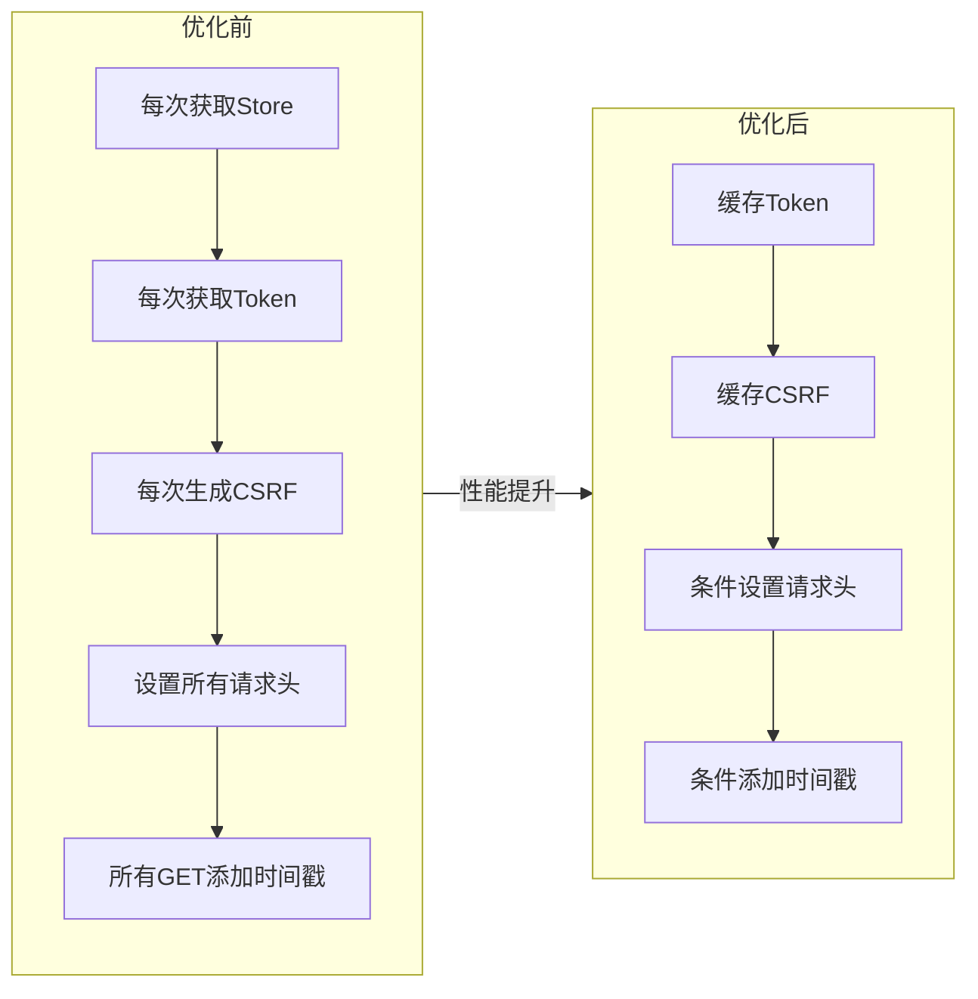

## 4. 性能优化前后对比图

### 4.1 响应时间对比

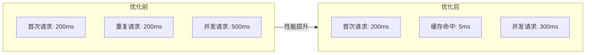

### 4.2 并发处理能力对比

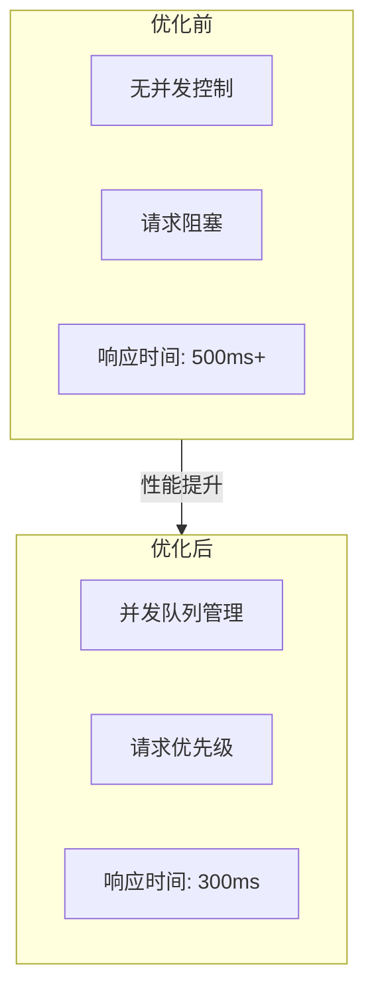

### 4.3 缓存命中率统计

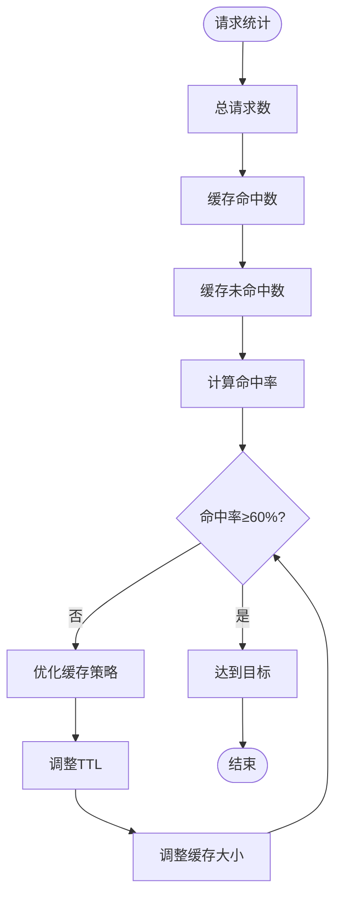

### 4.4 性能监控指标

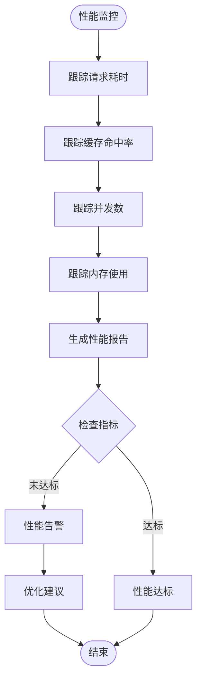

## 5. 完整性能优化流程

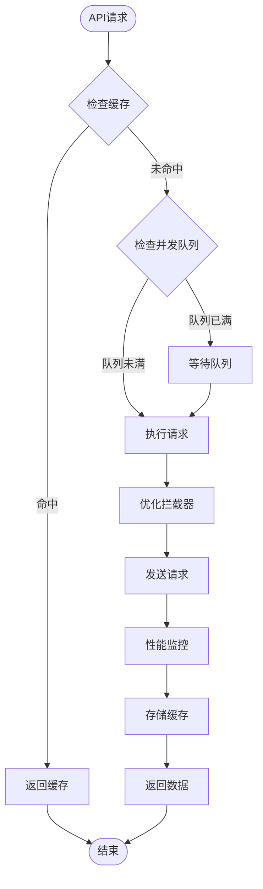

## 优化要点总结

1. **缓存机制**：
   - LRU缓存策略
   - TTL过期控制
   - 版本控制失效
   - 缓存大小限制

1. **并发控制**：
   - 最大并发数限制
   - 请求队列管理
   - 优先级处理
   - 请求去重

1. **拦截器优化**：
   - Token缓存
   - CSRF Token缓存
   - 条件请求头设置
   - 条件时间戳添加

1. **性能监控**：
   - 请求耗时统计
   - 缓存命中率统计
   - 并发数统计
   - 内存使用统计
