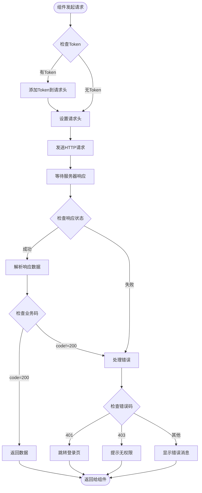
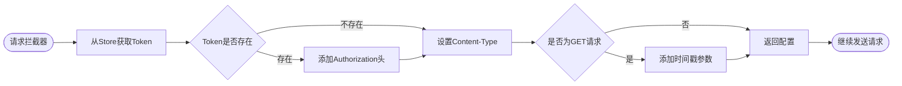
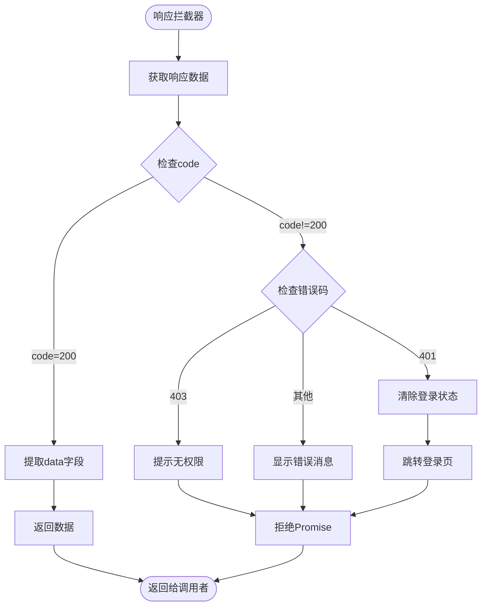
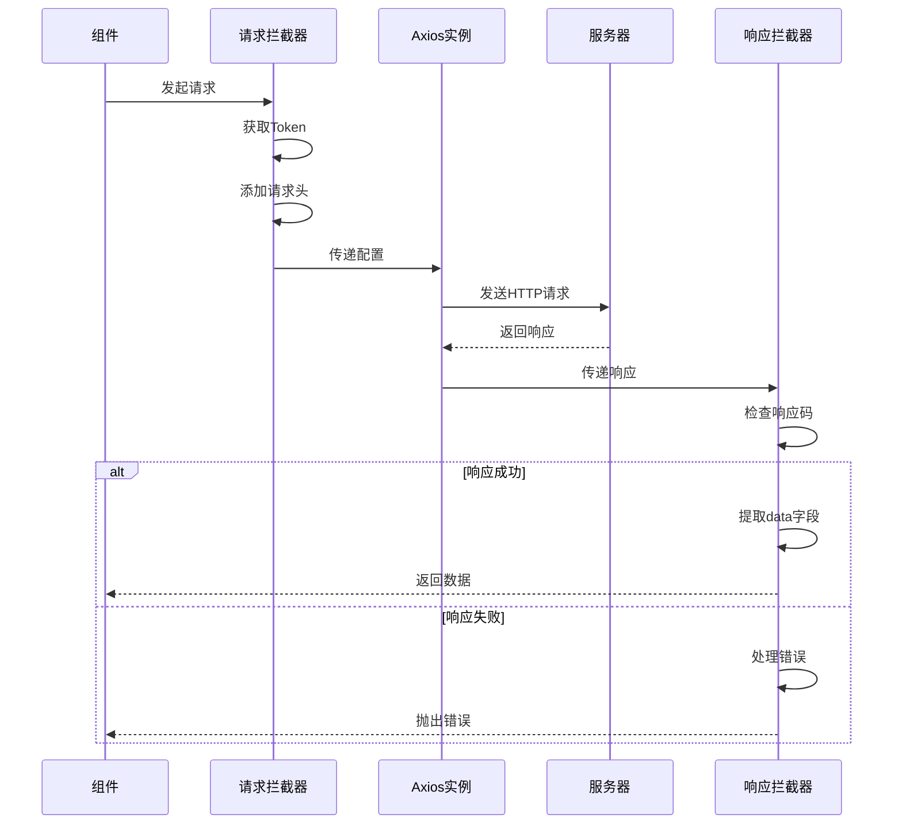
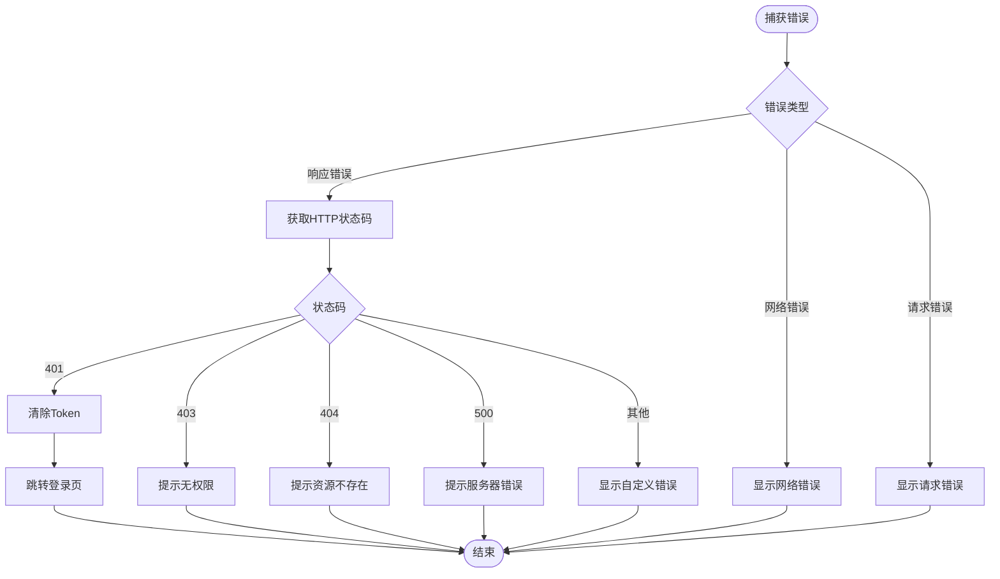
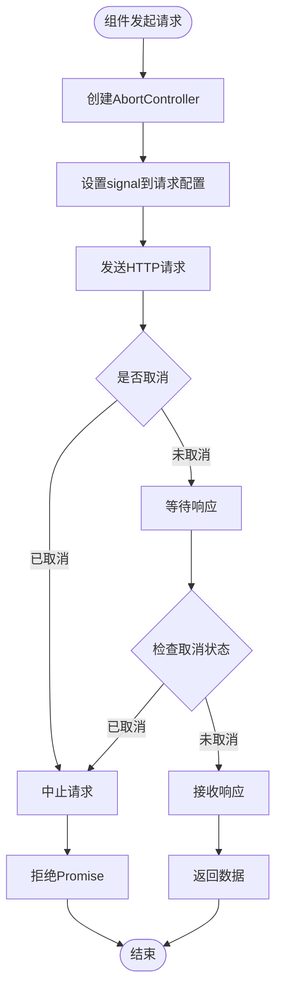
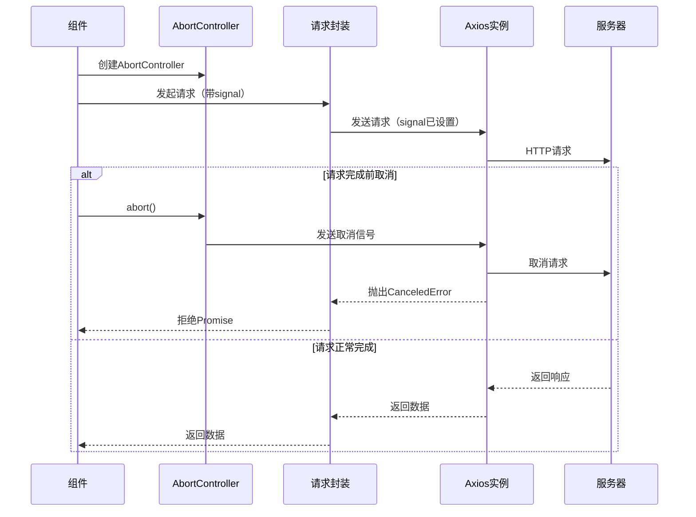
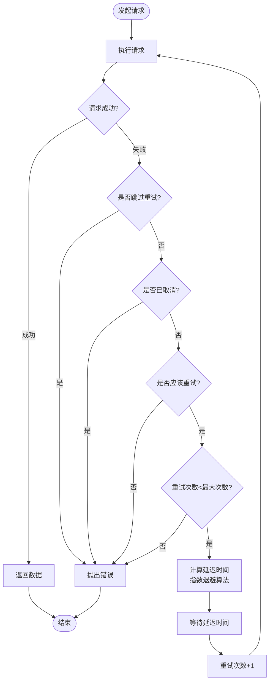
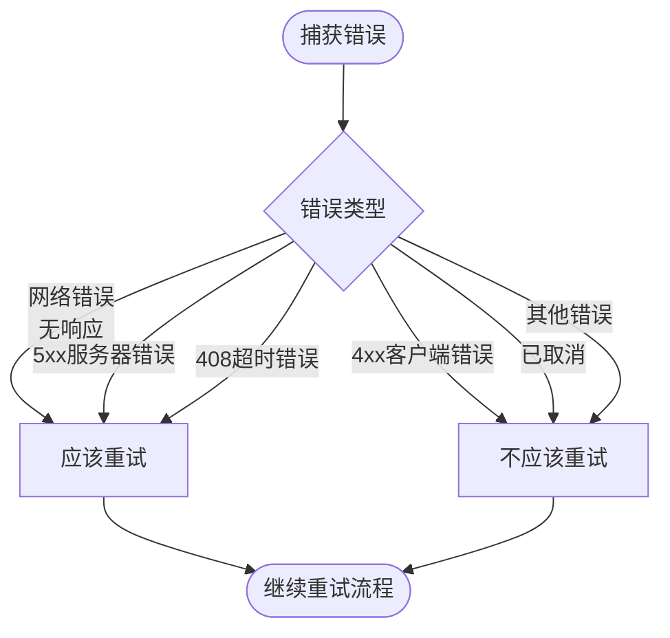

# API请求流程图

## API请求完整流程



## 请求拦截器流程



## 响应拦截器流程



## API请求时序图



## 错误处理流程



## 请求取消机制流程



## 请求取消时序图



## 请求重试机制流程



## 请求重试条件判断



## 指数退避算法

```mermaid
flowchart TD
    Start([计算重试延迟]) --> GetRetryCount[获取当前重试次数]
    GetRetryCount --> CalculateBase[计算基础延迟<br/>delay = 2^retryCount * 1000ms]
    CalculateBase --> CheckMaxDelay{延迟 > 最大延迟?}
    CheckMaxDelay -->|是| UseMaxDelay[使用最大延迟<br/>30000ms]
    CheckMaxDelay -->|否| UseCalculated[使用计算的延迟]
    UseMaxDelay --> ReturnDelay[返回延迟时间]
    UseCalculated --> ReturnDelay
    ReturnDelay --> End([等待后重试])
    
    Note1[示例:<br/>第1次重试: 1000ms<br/>第2次重试: 2000ms<br/>第3次重试: 4000ms<br/>第4次重试: 8000ms<br/>...<br/>最大延迟: 30000ms]
```text
