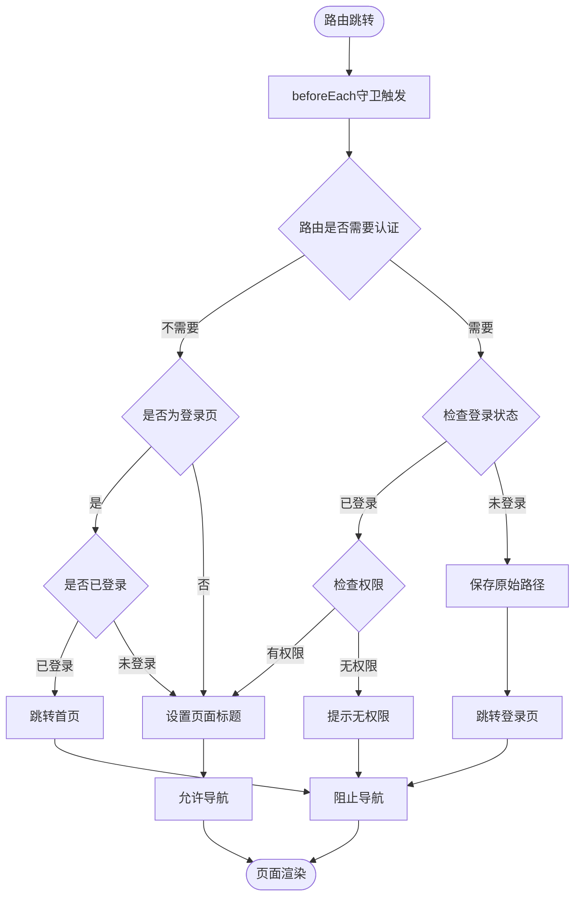
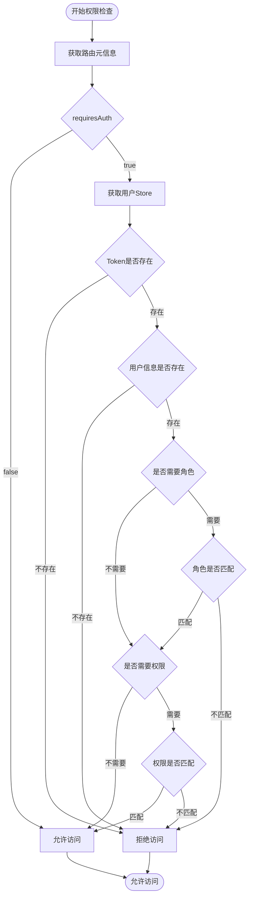
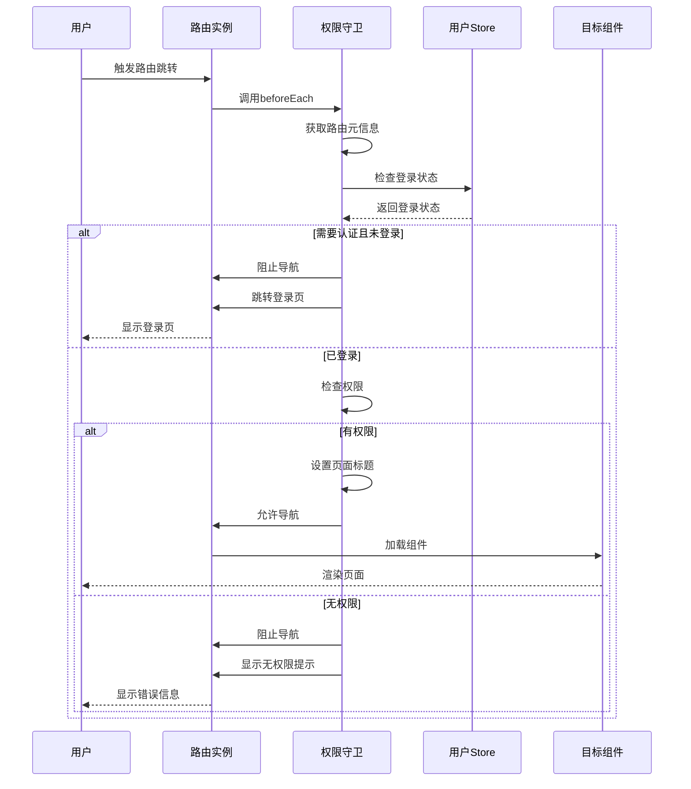
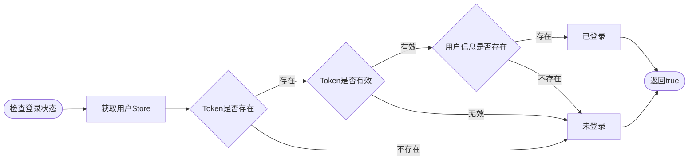

# 权限守卫流程图

## 路由守卫完整流程



## 权限校验决策树



## 路由守卫时序图



## 登录状态检查流程



## 权限不足处理流程

```mermaid
flowchart TD
    Start([权限不足]) --> CheckType{权限不足类型}
    CheckType -->|未登录| SavePath[保存原始路径]
    CheckType -->|无权限| ShowMessage[显示无权限提示]
    SavePath --> RedirectLogin[跳转到登录页]
    ShowMessage --> CheckAction{用户操作}
    CheckAction -->|返回上一页| GoBack[返回上一页]
    CheckAction -->|返回首页| RedirectHome[跳转首页]
    RedirectLogin --> End([结束])
    GoBack --> End
    RedirectHome --> End
```text
