# 构建产物优化流程图

本文档描述构建产物优化的流程图，包括代码分割、静态资源处理、打包体积优化和构建分析。

## 1. 代码分割策略流程图

### 1.1 路由懒加载流程

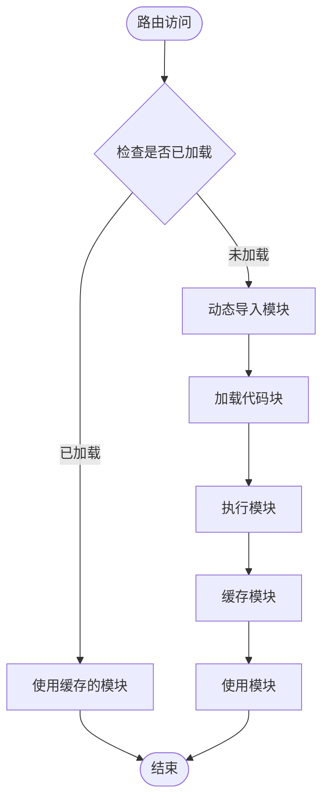

### 1.2 模块分割流程

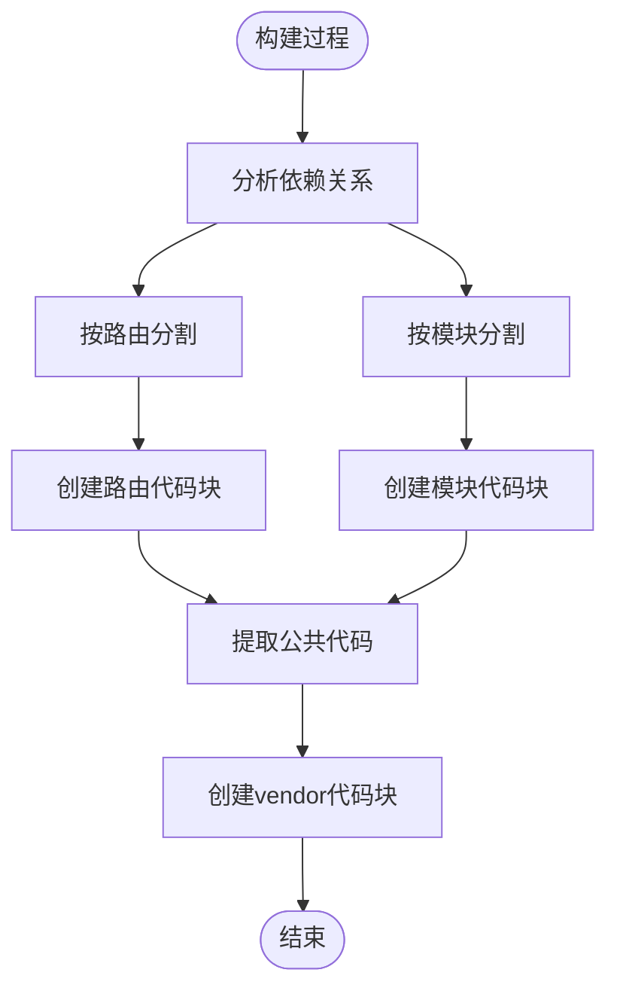

### 1.3 第三方库分割流程

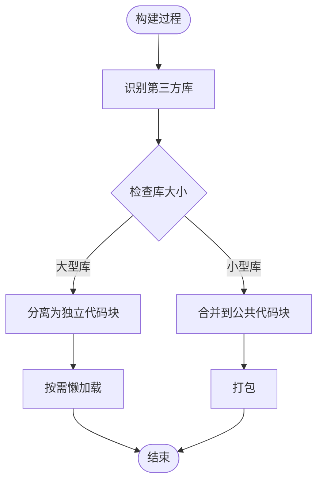

## 2. 静态资源处理优化流程图

### 2.1 图片压缩流程

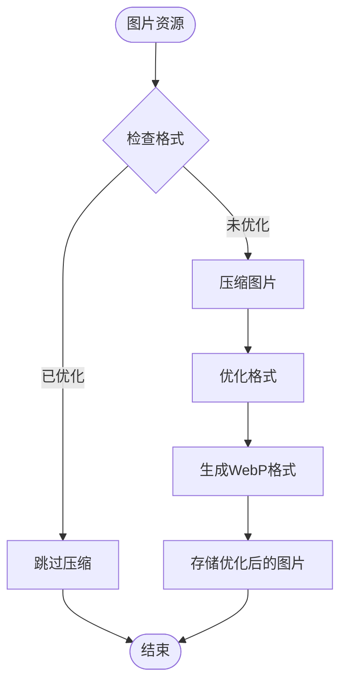

### 2.2 字体优化流程

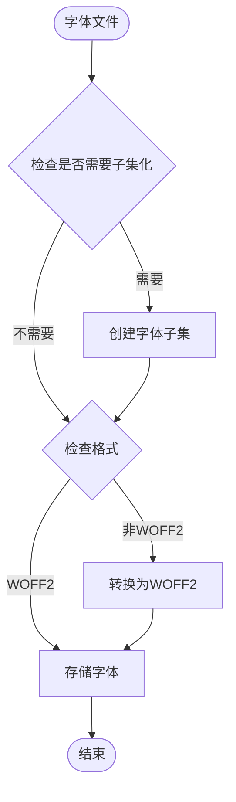

### 2.3 资源懒加载流程

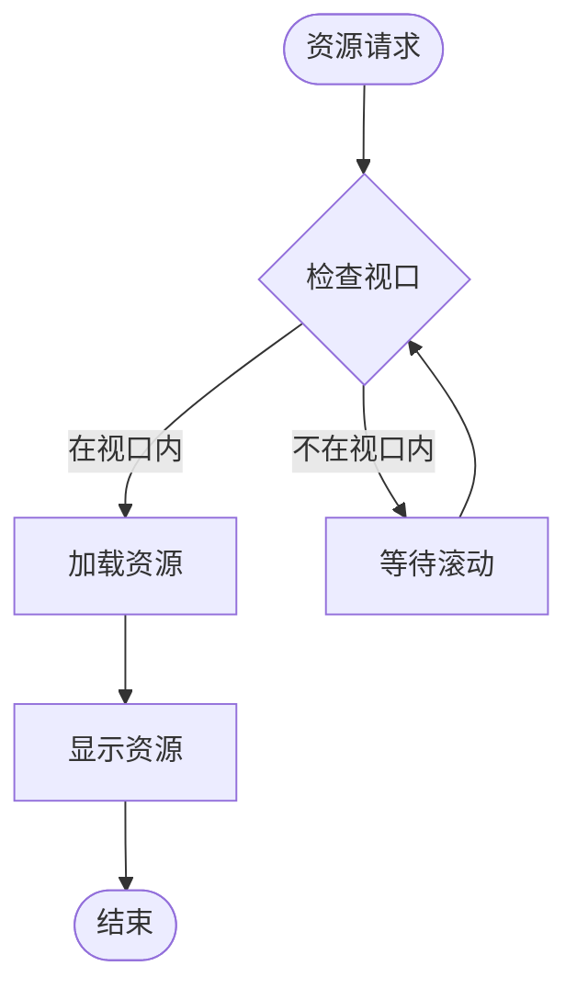

## 3. 打包体积优化流程图

### 3.1 tree-shaking流程

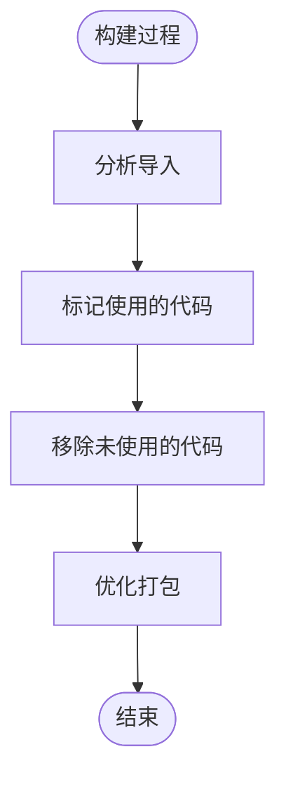

### 3.2 代码压缩流程

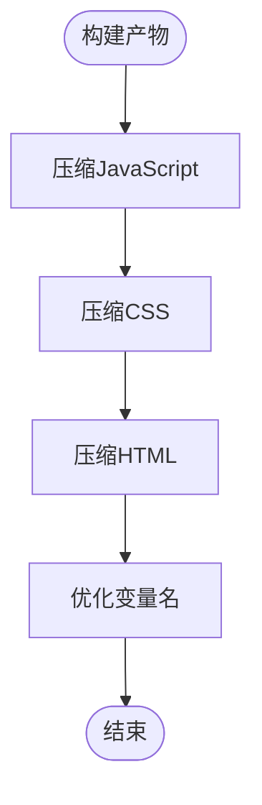

### 3.3 Gzip/Brotli压缩流程

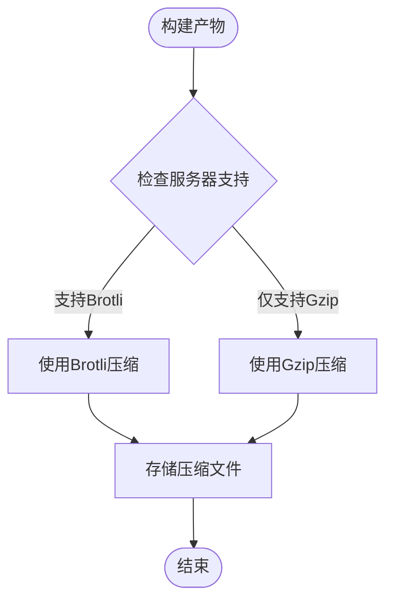

## 4. 构建产物分析图

### 4.1 体积分析流程

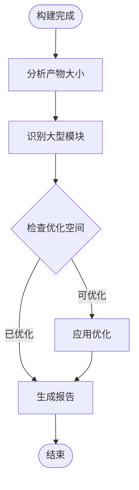

### 4.2 优化前后对比

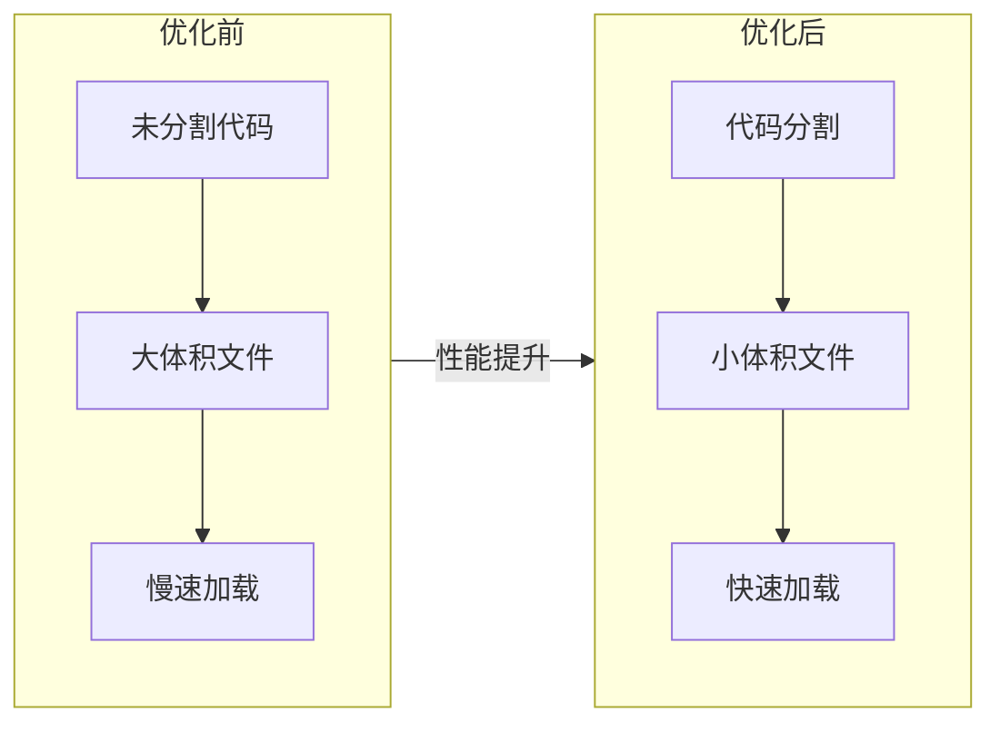

## 5. 完整构建优化流程

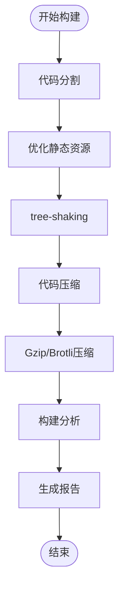

## 优化要点总结

1. **代码分割**：
   - 路由懒加载：使用动态import实现按需加载
   - 模块分割：按业务模块分割代码
   - 第三方库分割：vendor chunk分离
   - 公共代码提取：提取公共依赖

1. **静态资源优化**：
   - 图片压缩：使用vite-plugin-imagemin等
   - 字体优化：字体子集化、格式优化
   - CDN资源：将大型库迁移到CDN
   - 资源懒加载：图片懒加载、组件懒加载

1. **打包体积优化**：
   - tree-shaking：确保未使用代码被移除
   - 代码压缩：Terser、ESBuild压缩
   - Gzip/Brotli压缩：服务器端压缩
   - 依赖优化：按需引入、移除未使用依赖

1. **构建分析**：
   - vite-bundle-visualizer：可视化分析构建产物
   - 构建报告：生成构建产物分析报告
   - 产物大小监控：记录构建产物大小变化
