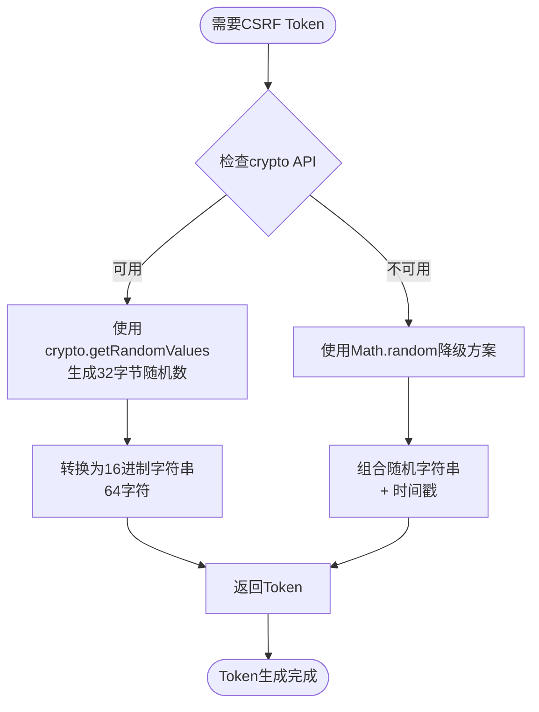
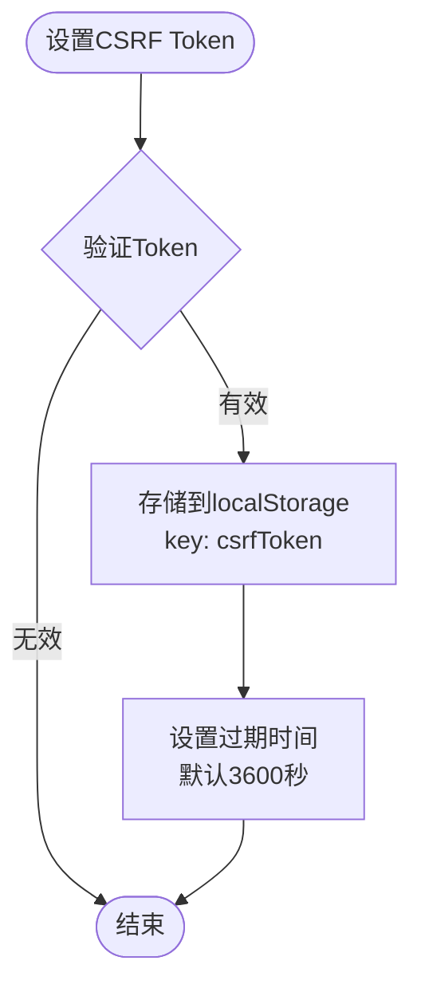
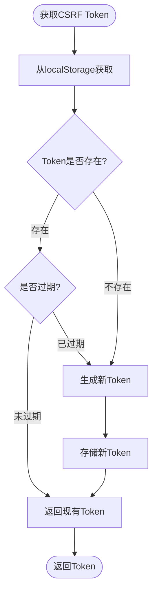
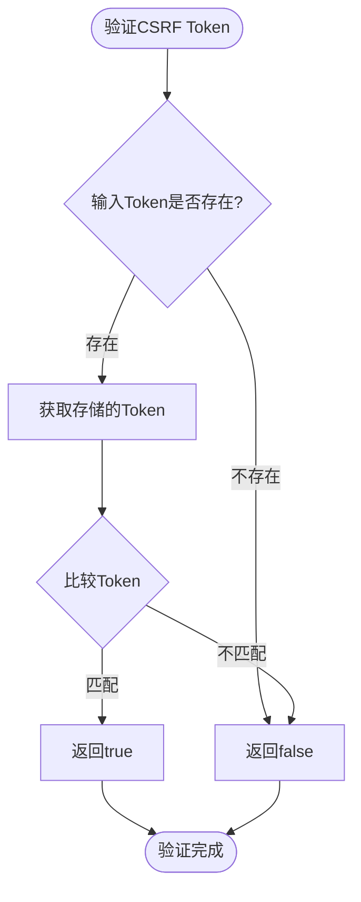
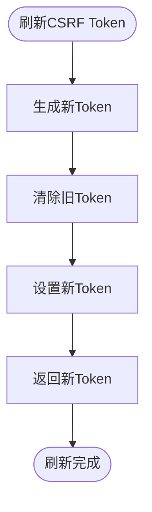
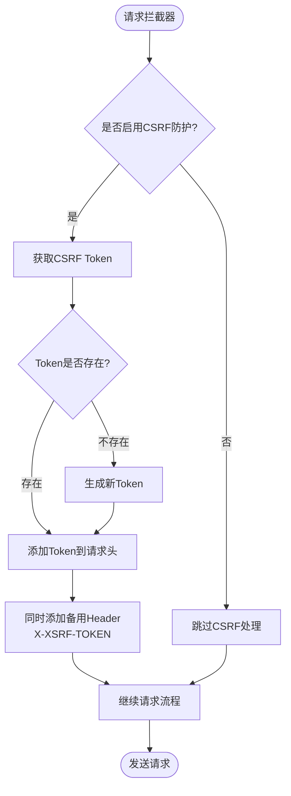
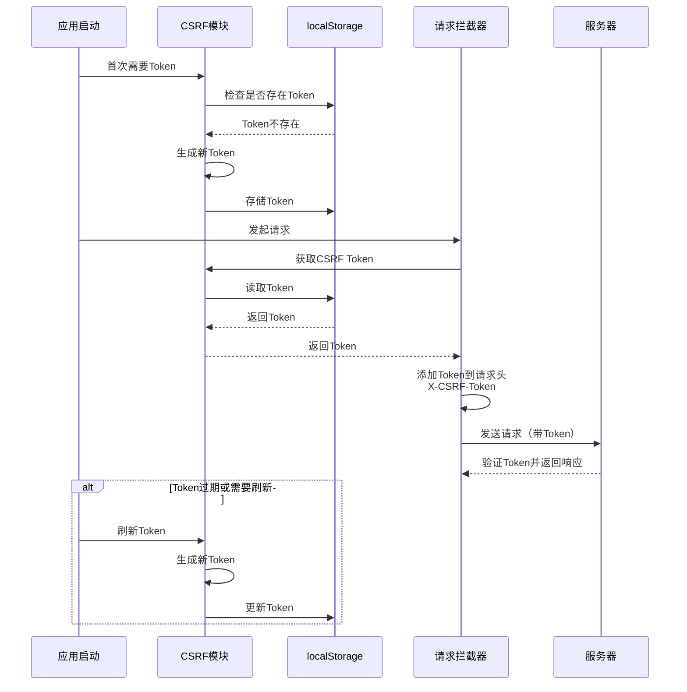

# CSRF防护流程图

## CSRF Token生成流程



## CSRF Token存储流程



## CSRF Token获取流程



## CSRF Token验证流程



## CSRF Token刷新流程



## CSRF防护在请求拦截器中的集成



## CSRF防护完整流程



## CSRF Token生命周期

```mermaid
stateDiagram-v2
    [*] --> 不存在: 应用启动
    不存在 --> 已生成: 首次获取Token
    已生成 --> 已存储: 存储到localStorage
    已存储 --> 已使用: 添加到请求头
    已使用 --> 已存储: 请求完成
    已存储 --> 已过期: 超过3600秒
    已过期 --> 已生成: 重新生成
    已存储 --> 已刷新: 主动刷新
    已刷新 --> 已存储: 更新存储
    已存储 --> [*]: 清除Token
```text
