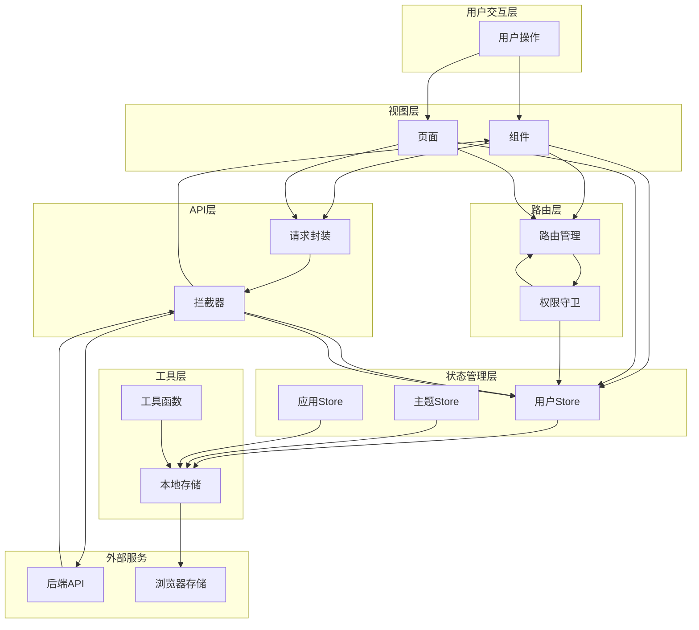
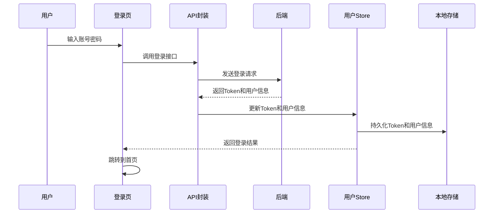

# 模块间数据流向图

## 完整数据流向



## 登录流程数据流



## 状态更新数据流

```mermaid
flowchart LR
    Component[组件] -->|调用方法| Store[Store]
    Store -->|更新状态| ReactiveState[响应式状态]
    ReactiveState -->|触发更新| Component
    Store -->|持久化| Storage[本地存储]
    Storage -->|恢复| Store
```text
