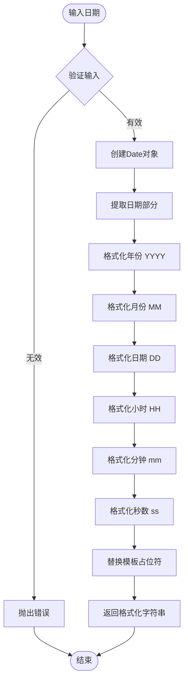
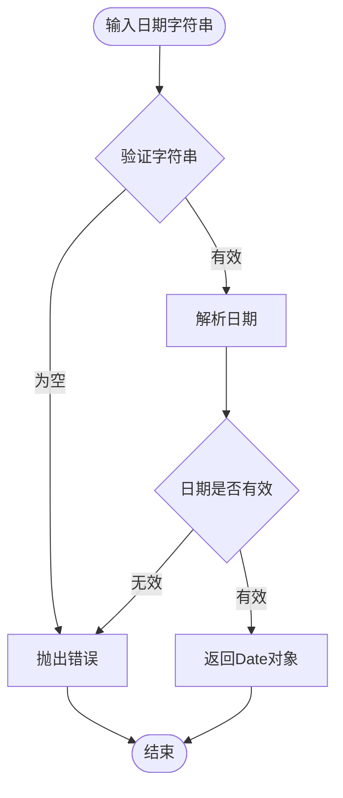

# 日期处理工具流程图

## 日期格式化流程



## 日期解析流程



## 日期计算流程

```mermaid
flowchart TD
    Start([输入基准日期和天数]) --> ValidateDate{验证日期}
    ValidateDate -->|无效| ThrowError[抛出错误]
    ValidateDate -->|有效| CloneDate[克隆日期对象]
    CloneDate --> GetCurrentDate[获取当前日期]
    GetCurrentDate --> AddDays[加上天数]
    AddDays --> CheckOverflow{检查溢出}
    CheckOverflow -->|溢出| AdjustMonth[调整月份]
    CheckOverflow -->|正常| ReturnDate[返回新日期]
    AdjustMonth --> CheckYearOverflow{检查年份溢出}
    CheckYearOverflow -->|溢出| AdjustYear[调整年份]
    CheckYearOverflow -->|正常| ReturnDate
    AdjustYear --> ReturnDate
    ThrowError --> End([结束])
    ReturnDate --> End
```text
