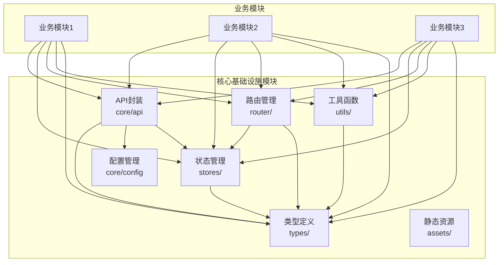
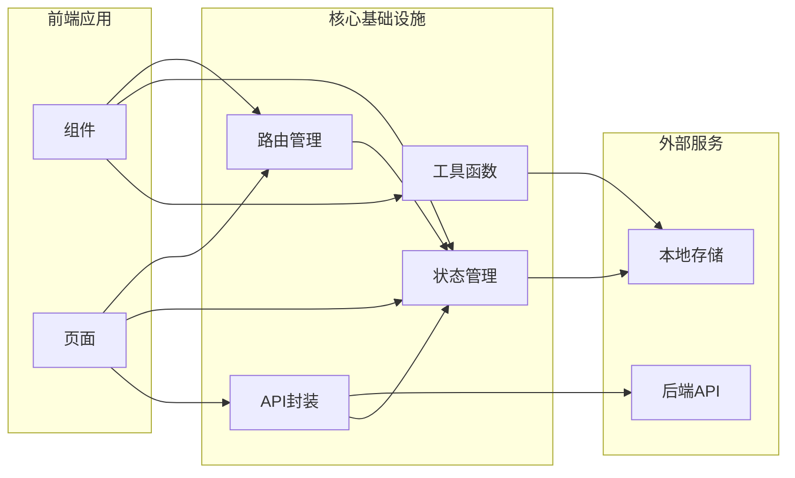

# 核心基础设施模块依赖关系图

## 模块依赖关系

## 数据流向图

## 模块说明

- **API封装**：提供统一的HTTP请求接口，处理请求拦截、响应拦截、错误处理
- **配置管理**：管理环境变量、常量定义
- **类型定义**：提供TypeScript类型定义，确保类型安全
- **状态管理**：基于Pinia的全局状态管理
- **路由管理**：基于vue-router的路由配置和权限守卫
- **工具函数**：提供日期、字符串、加密、校验、存储等工具函数
- **静态资源**：CSS变量、通用样式等静态资源
