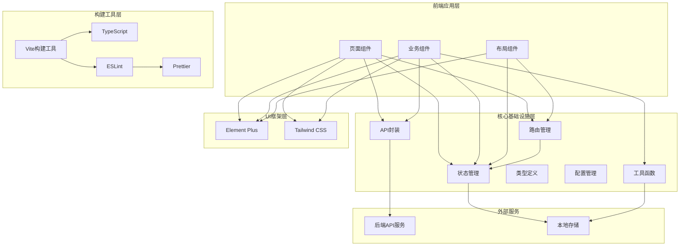

# 项目整体架构图

## 系统架构



## 目录结构树状图

```text
src/
├── core/                    # 核心模块
│   ├── api/                 # API封装
│   │   ├── request.ts       # HTTP请求封装
│   │   ├── types.ts         # API类型定义
│   │   └── index.ts         # API导出
│   ├── config/              # 配置管理
│   │   ├── env.ts           # 环境配置
│   │   ├── constants.ts     # 常量定义
│   │   └── index.ts         # 配置导出
│   └── constants/           # 常量定义（备用）
│       └── index.ts
├── utils/                   # 工具函数
│   ├── date.ts              # 日期处理
│   ├── string.ts            # 字符串处理
│   ├── encrypt.ts           # 加密解密
│   ├── validate.ts          # 数据校验
│   ├── storage.ts           # 本地存储
│   └── index.ts             # 工具函数导出
├── types/                   # TypeScript类型定义
│   ├── api.ts               # API类型
│   ├── common.ts            # 通用类型
│   ├── user.ts              # 用户类型
│   └── index.ts             # 类型导出
├── stores/                  # Pinia状态管理
│   ├── modules/             # 状态模块
│   │   ├── user.ts          # 用户状态
│   │   ├── theme.ts         # 主题状态
│   │   └── app.ts           # 应用状态
│   ├── types/               # Store类型定义
│   │   └── index.ts
│   └── index.ts             # Store导出
├── router/                  # 路由配置
│   ├── modules/              # 路由模块
│   │   ├── index.ts         # 路由定义
│   │   └── routes.ts        # 路由配置
│   ├── guards/              # 路由守卫
│   │   ├── auth.ts          # 权限守卫
│   │   └── index.ts         # 守卫导出
│   └── index.ts             # 路由导出
└── assets/                  # 静态资源
    ├── images/              # 图片资源
    ├── styles/              # 样式文件
    │   ├── variables.css    # CSS变量
    │   ├── common.css       # 通用样式
    │   └── index.css        # 样式入口
    └── fonts/               # 字体文件
```text
