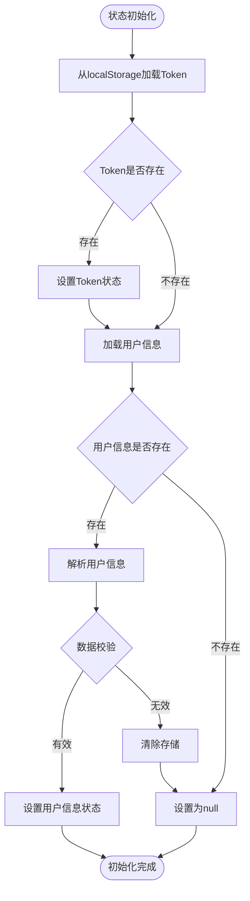
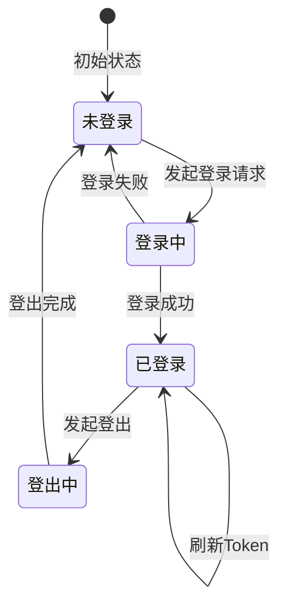
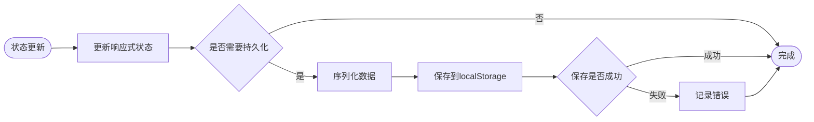
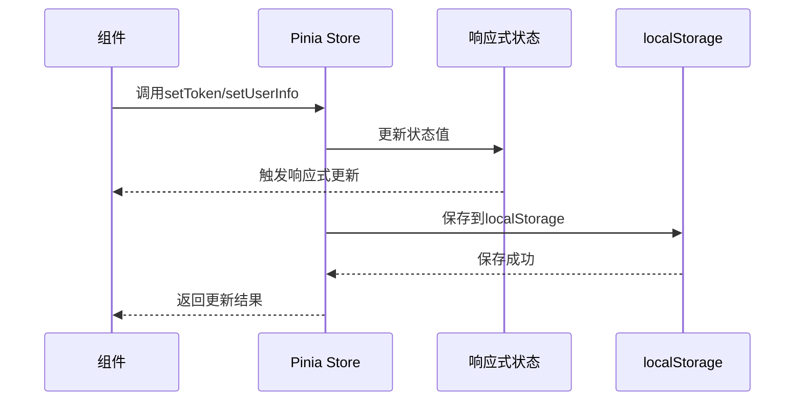

# 状态管理流程图

## 用户状态管理流程



## 登录状态流转图



## 状态持久化流程



## 状态更新时序图



## 用户信息更新流程

```mermaid
flowchart TD
    Start([setUserInfo调用]) --> ValidateInput{验证输入}
    ValidateInput -->|无效| Reject[拒绝更新]
    ValidateInput -->|有效| UpdateState[更新userInfo状态]
    UpdateState --> Serialize[序列化为JSON]
    Serialize --> SaveStorage[保存到localStorage]
    SaveStorage --> CheckError{保存是否成功}
    CheckError -->|成功| NotifyComponents[通知组件更新]
    CheckError -->|失败| LogError[记录错误]
    NotifyComponents --> End([更新完成])
    LogError --> End
    Reject --> End
```text
