# 状态管理性能优化流程图

本文档描述状态管理性能优化的流程图，包括响应式优化、持久化优化、更新频率优化和性能对比。

## 1. Store响应式性能优化流程图

### 1.1 shallowRef优化流程

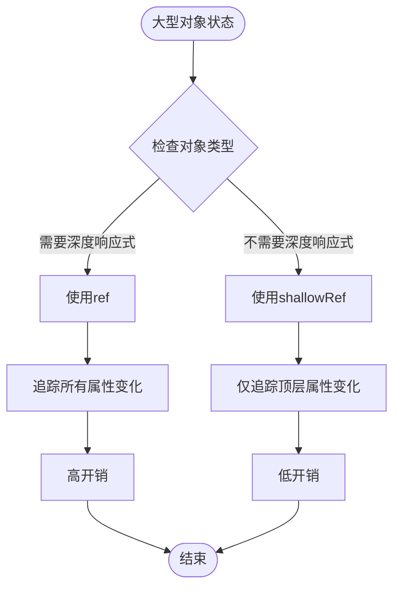

### 1.2 markRaw优化流程

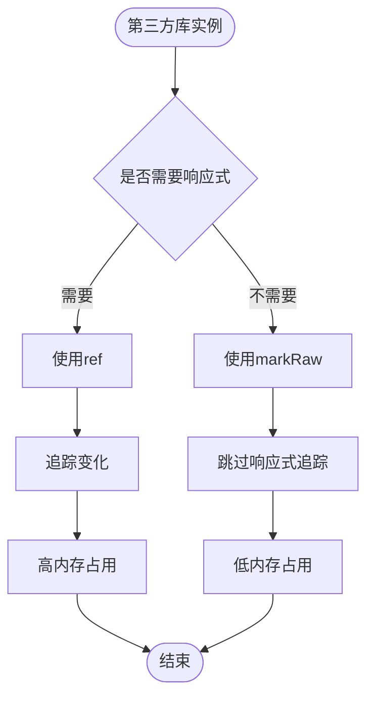

### 1.3 计算属性依赖优化流程

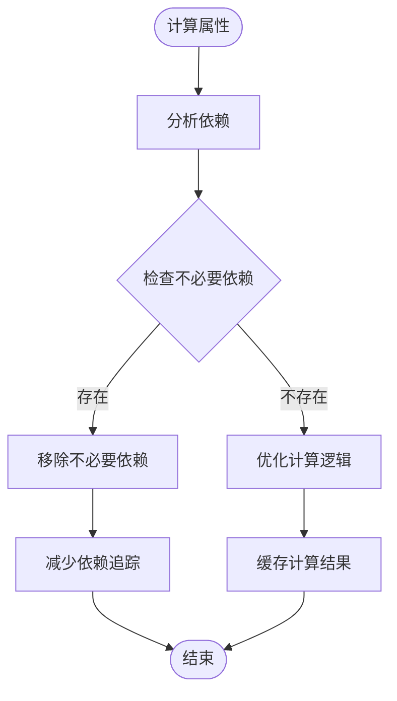

## 2. 状态持久化优化流程图

### 2.1 批量写入流程

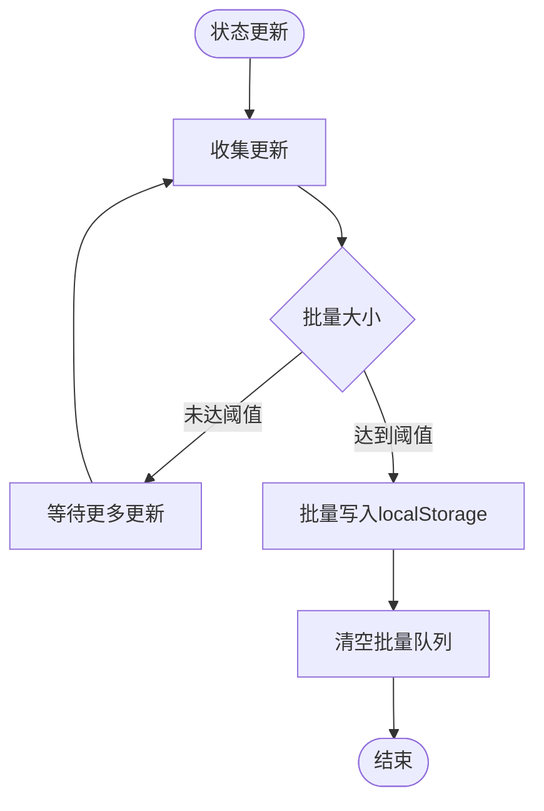

### 2.2 防抖机制流程

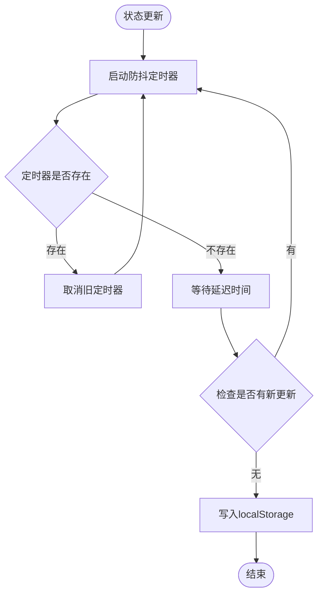

### 2.3 节流机制流程

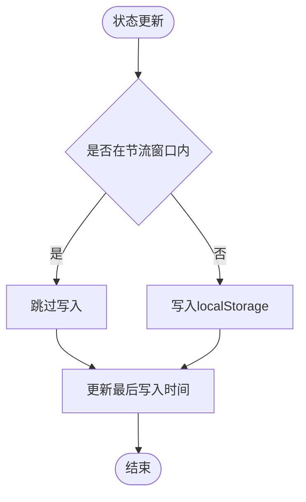

### 2.4 持久化队列流程

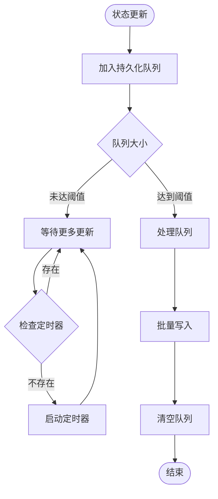

## 3. 状态更新频率优化流程图

### 3.1 状态更新合并流程

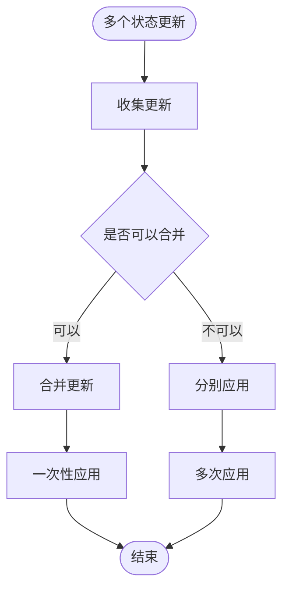

### 3.2 批量更新机制流程

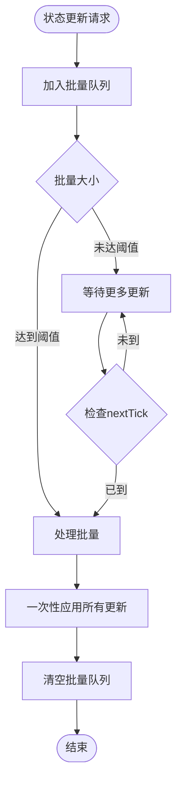

### 3.3 更新去重流程

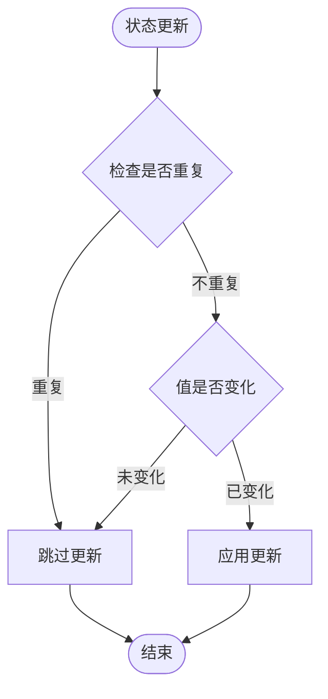

## 4. 性能优化前后对比图

### 4.1 响应速度对比

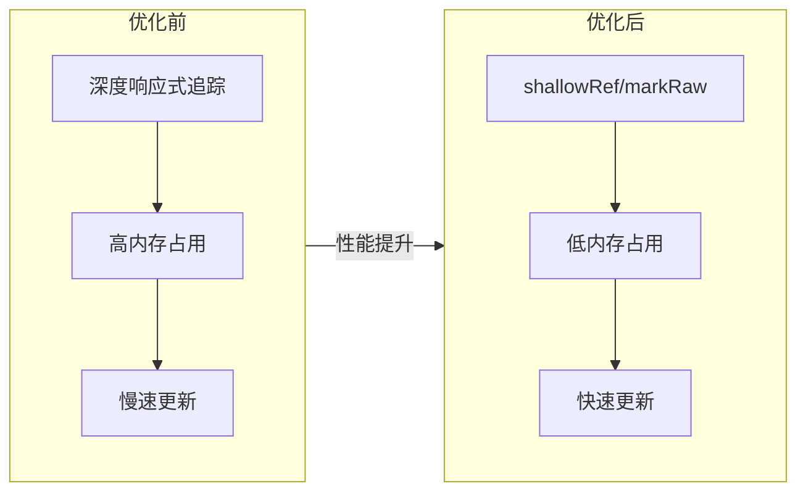

### 4.2 持久化性能对比

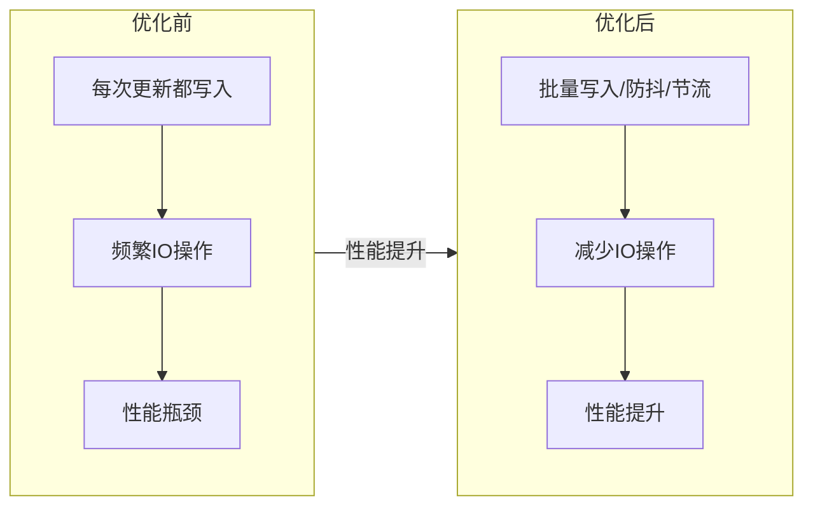

### 4.3 更新频率对比

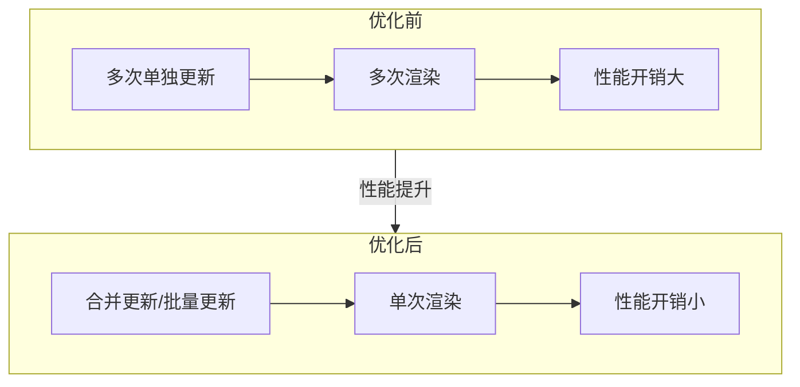

## 5. 完整性能优化流程

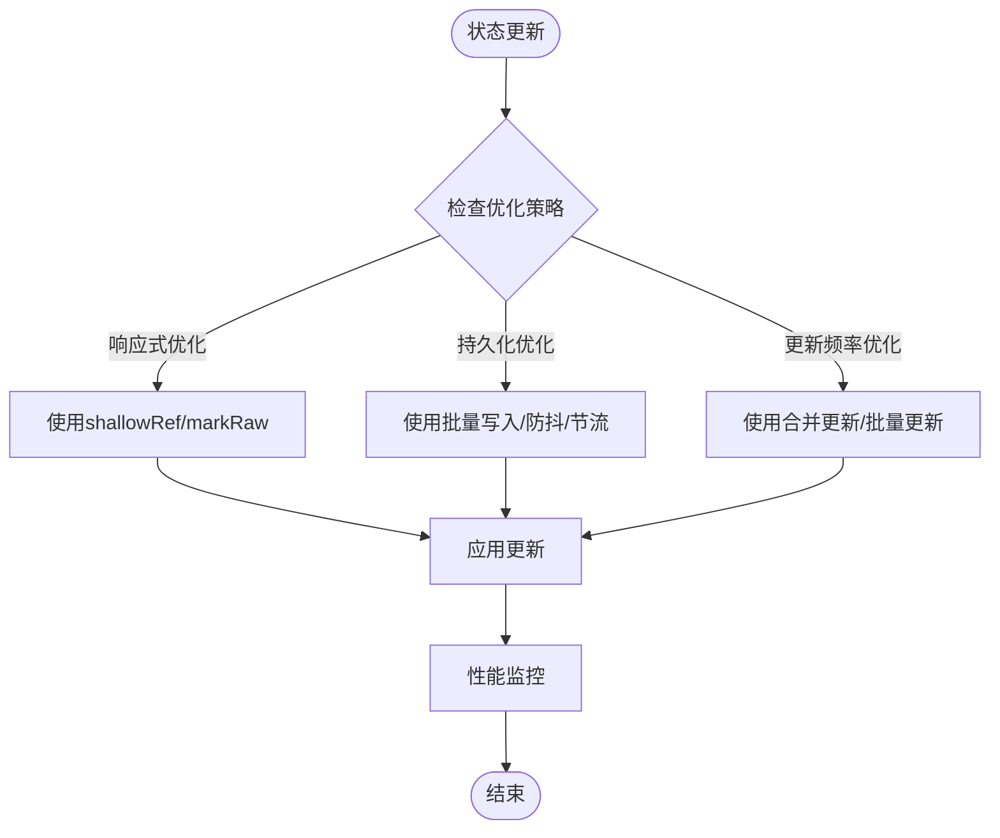

## 优化要点总结

1. **响应式优化**：
   - shallowRef：减少深度响应式开销
   - markRaw：标记不需要响应式的对象
   - 计算属性依赖优化：减少不必要的依赖追踪

1. **持久化优化**：
   - 批量写入：收集多个更新，批量写入localStorage
   - 防抖机制：延迟写入，等待状态稳定
   - 节流机制：限制写入频率
   - 持久化队列：管理待持久化的状态更新

1. **更新频率优化**：
   - 状态更新合并：合并多个连续的状态更新
   - 批量更新机制：收集多个更新，一次性应用
   - 更新去重：避免重复更新相同状态
   - nextTick优化：优化状态更新时机
