# 工具函数性能优化流程图

本文档描述工具函数性能优化的流程图，包括日期处理、字符串处理、数据校验优化和性能对比。

## 1. 日期处理性能优化流程图

### 1.1 格式化结果缓存流程

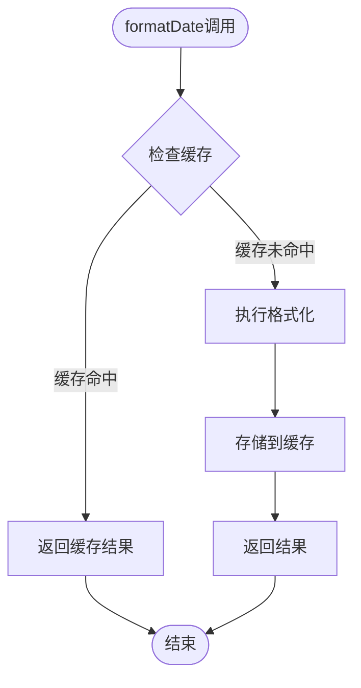

### 1.2 算法优化流程

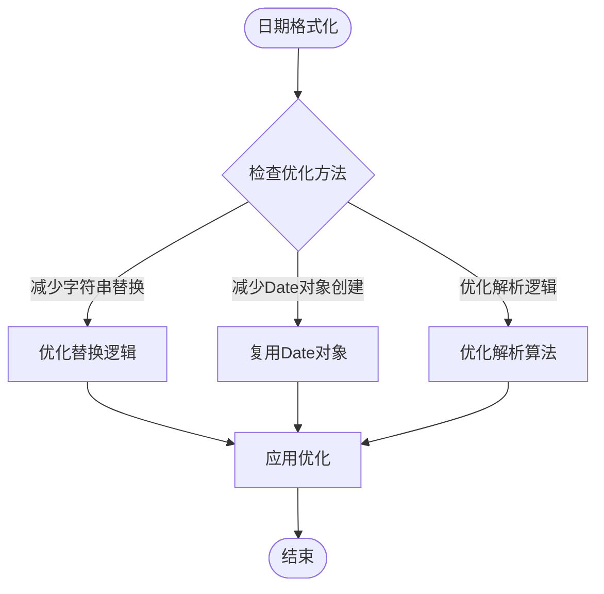

## 2. 字符串处理性能优化流程图

### 2.1 正则表达式优化流程

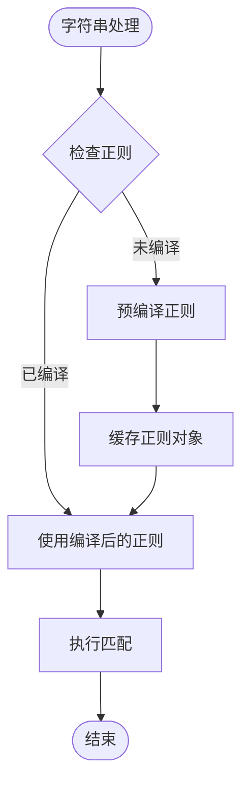

### 2.2 字符串操作优化流程

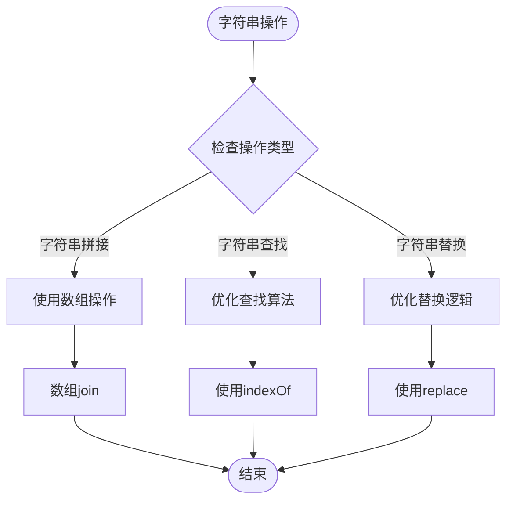

### 2.3 结果缓存流程

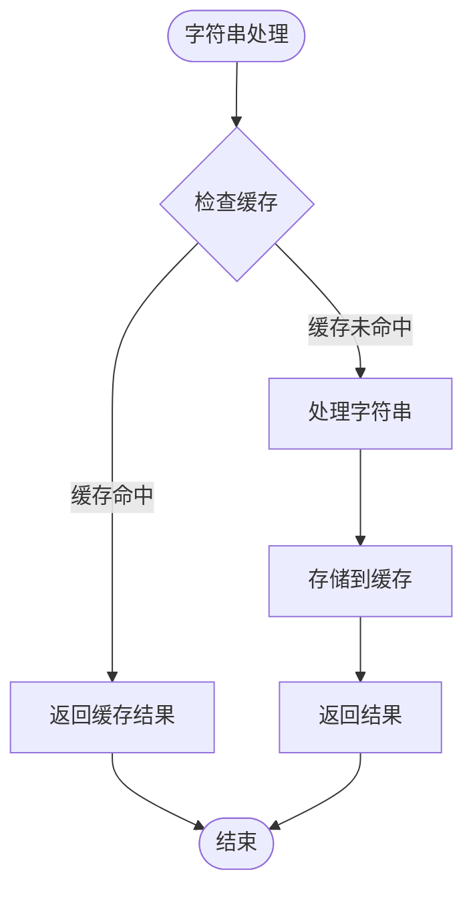

## 3. 数据校验性能优化流程图

### 3.1 正则表达式优化流程

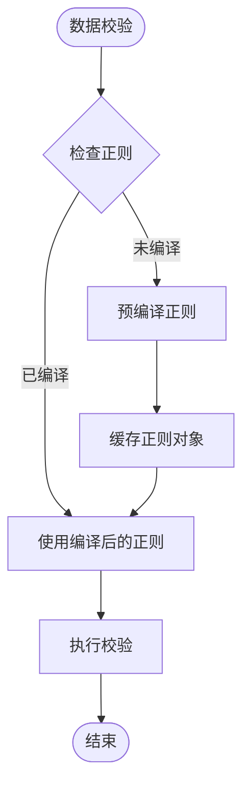

### 3.2 校验结果缓存流程

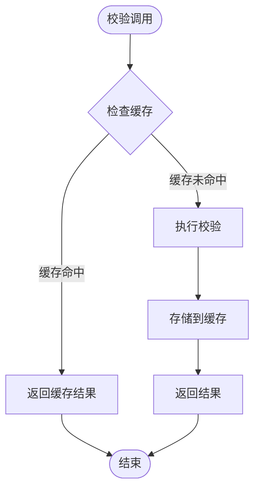

### 3.3 校验器复用流程

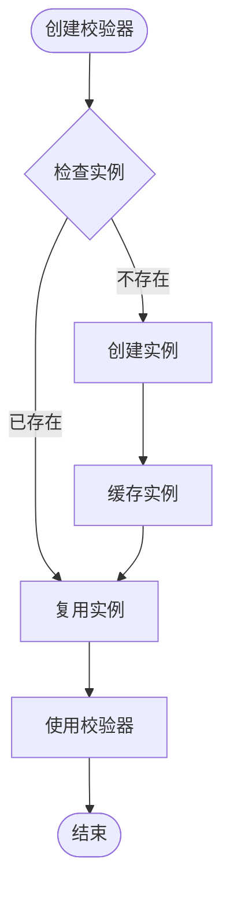

## 4. 性能优化前后对比图

### 4.1 执行时间对比

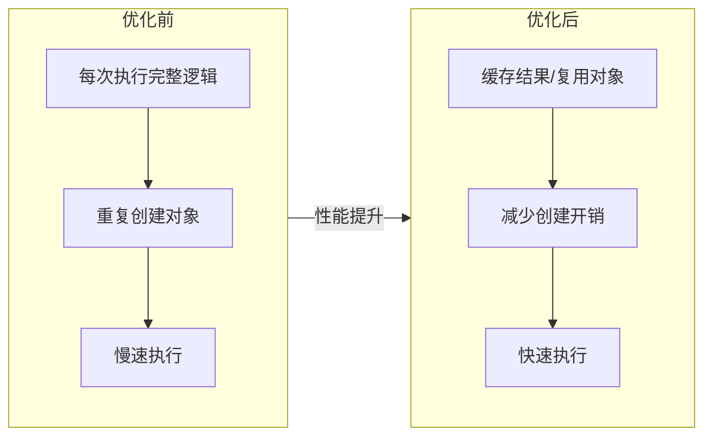

### 4.2 内存使用对比

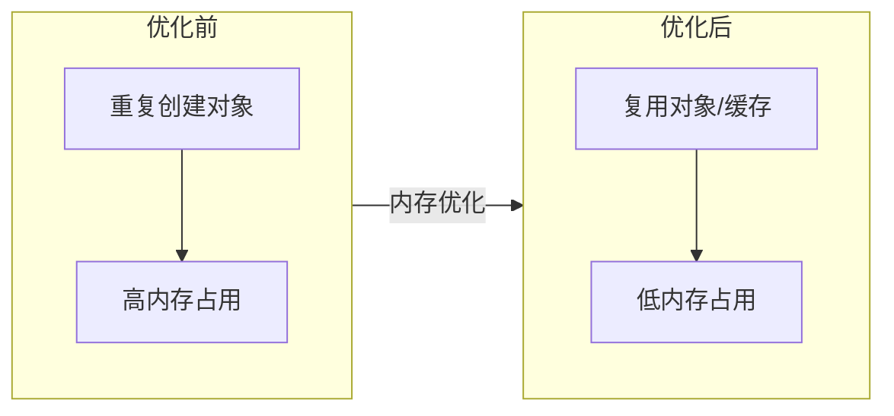

### 4.3 缓存命中率统计

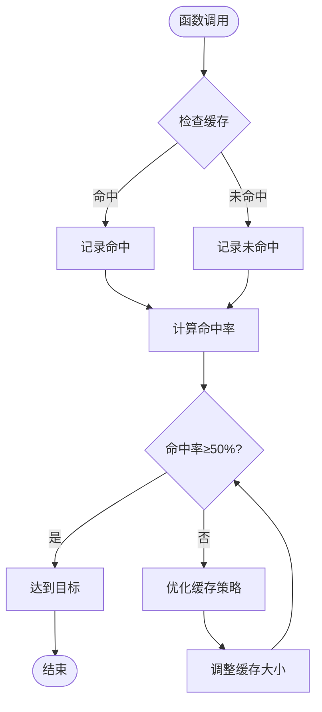

## 5. 完整性能优化流程

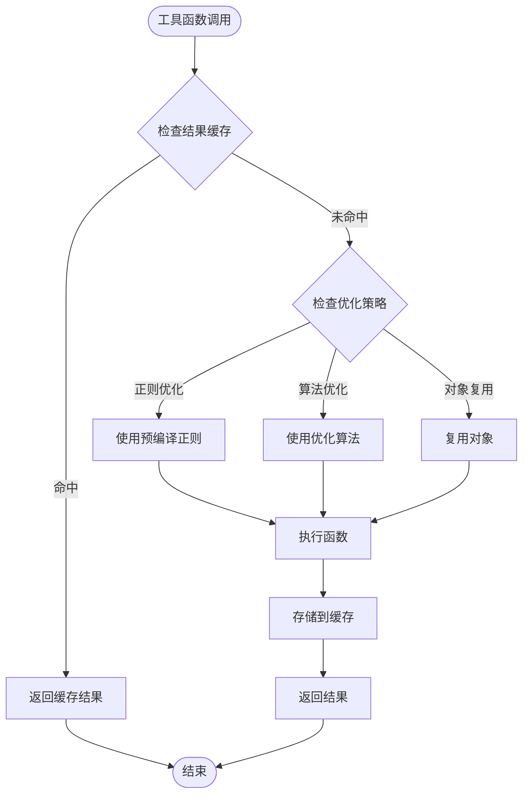

## 优化要点总结

1. **日期处理优化**：
   - 格式化结果缓存：缓存常用格式的格式化结果
   - 算法优化：减少字符串替换次数、减少Date对象创建
   - 解析优化：优化日期解析逻辑

1. **字符串处理优化**：
   - 正则预编译：预编译正则表达式，缓存正则对象
   - 字符串操作优化：使用数组操作替代字符串拼接
   - 结果缓存：缓存常用操作的转换结果

1. **数据校验优化**：
   - 正则预编译：预编译正则表达式，缓存正则对象
   - 校验结果缓存：缓存常用值的校验结果
   - 校验器复用：复用校验器实例，避免重复创建
